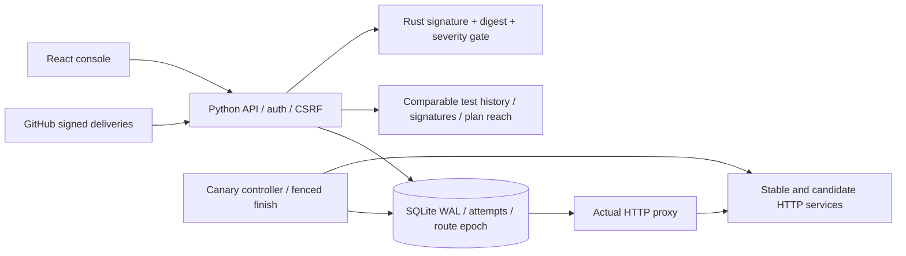
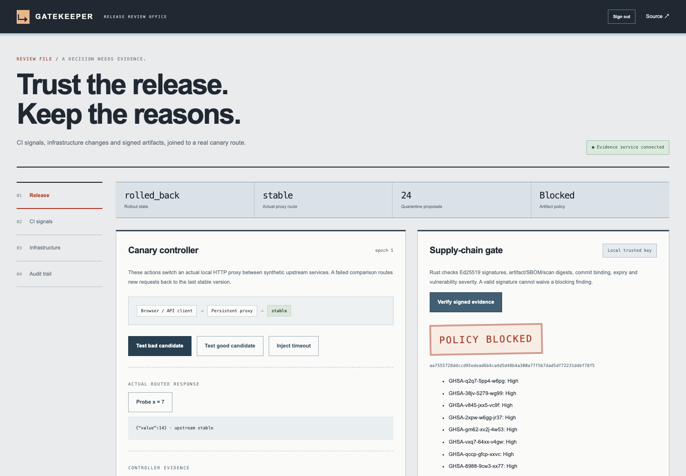

# Gatekeeper

1. **Problem:** CI noise, stale rollout controllers and signed unsafe artifacts can turn incomplete evidence into an unsafe release decision.

2. **Result:**

- Seeded flakes: precision 100%, recall 100%, 24 injected tests across 3,856 observations; risky plans caught 6/6, 0 false positives among 10 fixtures. [Raw analysis](docs/results/analysis.json)
- Signatures: 10 groups / 80 synthetic logs, purity and pairwise recall 1.00/1.00; 4 selected public excerpts / 2 groups, purity and pairwise recall 1.00/1.00. Related excerpts and hand selection limit this public result. [Labels](fixtures/public/ci.json)
- Real HTTP: 2 rollbacks, 1 promotion and SIGKILL/restart recovery; Rust blocked 8 High findings among 11 advisories in old dependency metadata; current-version control passed. [Proxy evidence](docs/results/canary.json) · [Scanner evidence](docs/results/supply.json)

3. **Architecture:**





[Visual design references and UI checks](docs/UI.md) · [Redesigned console recording](docs/results/ui-redesign/demo.webm). Historical benchmark evidence remains separate.

4. **Run it:**

```sh
python3 scripts/configure.py
docker compose up --build --wait
docker compose exec api python -m gatekeeper.seed
```

Open http://localhost:8082 and use the generated password in ignored `.env`. Docker Compose and Python are prerequisites. Compose waits for the API health check before the seed command. The console computes real seeded analyses and routes real local requests. Saved scanner attestations expire; use the [native reproduction guide](docs/REPRODUCE.md) to prepare fresh signed evidence.


5. **Decisions and limits:**

**Partial.** [Vercel evidence site](https://gatekeeper-ten-sandy.vercel.app) presents the real recording and saved results. A persistent interactive backend is not hosted. GitHub App manifest, signature ingestion and token plumbing exist; installation and live JUnit artifact ingestion remain unfinished. PR Markdown previews are available; posting is disabled. Workflow-level metadata is not test-level flake evidence. All benchmarks use synthetic or public data and original code.

SQLite and an API controller are deliberately single-host; requests already in flight may finish on the old upstream. A whole-host outage, multi-replica ownership, fleet convergence and scale latency are not measured. Terraform rules cover AWS root modules and reject unsupported module/provider identities. Dependency reach is not causal impact. The negative supply fixture contains metadata, not installed vulnerable code; it is not a scan of the whole app. Local Ed25519 trust is not SLSA or transparency logging. See [design](docs/DESIGN.md), [ADRs](docs/adr/), [quality checkpoint](docs/QUALITY.md), [interview guide](INTERVIEW.md), [drill](docs/DRILL.md), and [salvage record](docs/migration/gatekeeper.md).

Caught failures are retained: [real signed vulnerability rejection](docs/results/supply/verdict.json), [artifact tampering](docs/results/supply/tamper-rejected.json), [initial Syft shape integration failure](docs/results/initial-syft-shape-failure.log), and [browser-discovered rate budget failure](docs/results/initial-browser-rate-failure.log). The two integration bugs were corrected and covered by subsequent checks. Reproduce standard verification with `make lint test bench`; raw outputs live in [docs/results](docs/results/).

6. **Next:**

Install the App in an authorized test repo; ingest public JUnit artifacts with held-out labels; implement reviewed quarantine lifecycle; add provider-aware nested-module plan resolution; establish distributed controller ownership and persistent interactive hosting; bind signing to an audited builder identity and scanner-database freshness. Full scope beyond the local demo remains explicitly partial.

Contextual motion uses finite transform-only responses to real controls and changed evidence, with live reduced-motion cancellation. See [motion design and validation](docs/MOTION.md); frame rate is not measured.
